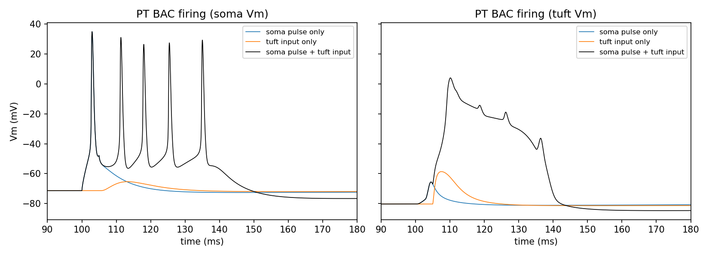

# tc-phase1-cells

Phase 1 of a thalamocortical model: the single cells and the physiology gate they must pass before they are wired into a circuit.

## Background

Eight cell types, built in NEURON and described as NetPyNE `cellParams`:

| Cell | Region | Compartments | Main currents |
|---|---|---|---|
| IT | cortex (L2/3, L4, L5A, L6) | soma + dendrite | Na, K, M |
| CT | cortex (L6, corticothalamic) | soma + dendrite | Na, K, M |
| PT | cortex (L5B, pyramidal tract) | soma, basal, apical trunk, apical tuft | Na, K, M, Ih; tuft Ca hot zone (HVA Ca, T-type Ca, SK) |
| PV | cortex | soma | Na, K (fast spiking) |
| SOM | cortex | soma + dendrite | Na, K, M, T-type Ca (low-threshold spiking) |
| VIP | cortex | soma | Na, K, M |
| TC | thalamus (relay) | soma | Na, K, T-type Ca, Ih |
| TRN | thalamus (reticular) | soma | Na, K, shifted T-type Ca |

The TC cell follows Destexhe et al. (1998) [1]. Each channel file names its source at the top.

The gate (`phase1_gate.py`) puts each cell under current clamp and runs 51 checks:

- **all cells:** resting Vm, input resistance, spike half-width, spike peak above 0 mV
- **cortical cells:** spike-frequency adaptation within a cell-type window
- **IT, CT, PT:** still firing at the end of a 0.4 nA, 500 ms step (no depolarization block)
- **TC, TRN:** burst from -75 mV, tonic firing from -58 mV, rebound burst after hyperpolarization
- **SOM:** rebound spike after hyperpolarization
- **PT:** BAC firing. A 5 ms somatic pulse alone gives 1 spike. An EPSC-shaped current into the tuft alone gives no somatic spike. The two together, 5 ms apart, give a burst of 3 or more spikes and a tuft Ca spike longer than 10 ms. The protocol follows Larkum et al. (1999) [6].

A cell that fails a check gets its conductances retuned, and the gate is run again.

### Structure of Repository (Phase-1)

```
tc-phase1-cells/
├── run.sh            compiles mod/ and runs the gate
├── cells.py          the 8 cell definitions (NetPyNE cellParams)
├── phase1_gate.py    current-clamp protocols, checks, figure
├── mod/              ion channels (NMODL)
│   ├── hh2.mod       fast Na / delayed-rectifier K
│   ├── km.mod        M current (adaptation)
│   ├── itcal.mod     T-type Ca
│   ├── hcur.mod      Ih
│   ├── cahva.mod     high-voltage-activated Ca
│   ├── cadyn.mod     Ca accumulation and decay
│   └── sk.mod        Ca-activated K (SK)
├── requirements.txt
└── results/
    ├── phase1_gate.json   every measured value and every check
    ├── phase1_gate.log    printed check list
    └── phase1_gate.png    PT BAC firing figure
```

### How to run

You need Python 3.10 or newer and a C compiler, which `nrnivmodl` uses (on macOS: `xcode-select --install`).

```bash
python3 -m venv .venv && source .venv/bin/activate
pip install -r requirements.txt
./run.sh
```

The first run compiles `mod/` and the whole gate takes about 30 s. The run ends with `51/51 checks passed` and exits non-zero if any check fails. Everything is deterministic, so a rerun gives the same numbers.

## RQ + Aim

The thalamus helps set how the cortex balances segregated processing (local, specialised) against integrated processing (brain-wide) [5, 7]. Thalamic relay cells fall along a gradient between two types:

- **core** (PVALB-rich): projects focally to the middle layers of one cortical area
- **matrix** (CALB1-rich): projects diffusely to layer 1 and to the apical tufts of L5 PT neurons across many areas [2, 3]

Matrix input that arrives with somatic spiking can trigger dendritic Ca bursts in PT cells. This makes the matrix pathway a candidate substrate for integrated cortical dynamics [4, 7].

The thesis asks whether raising the matrix share of thalamic drive (ρ) shifts the cortex from segregation toward integration, and whether cortical activity collapses onto fewer dimensions as it does. The model is built in three gated phases:

1. **single cells** (this repo)
2. **canonical thalamocortical microcircuit**
3. **16-area network sweep over ρ**

Phase 1 makes sure each cell type behaves like its biological counterpart before any synapses are added. The PT cell matters most: BAC firing is the mechanism through which matrix input is expected to act, so it has to be present at the single-cell level. In this phase core and matrix TC cells share one cell model. They differ only in where they project, which is set in Phase 2.

## Results of Phase-1 

All 51 checks pass.

| Cell | Vrest (mV) | Rin (MΩ) | Sag | Rheobase (nA) | AP peak (mV) | Half-width (ms) | AHP (mV) | Adaptation | Rate at 0.6 nA (Hz) | Cell-specific result | Checks |
|---|---|---|---|---|---|---|---|---|---|---|---|
| IT | -70.9 | 200 | 0.01 | 0.15 | 37.0 | 0.60 | 13.9 | 3.3 | 250 | fires to end of 0.4 nA step | 6/6 |
| CT | -72.3 | 208 | 0.00 | 0.15 | 37.0 | 0.60 | 13.6 | 6.8 | 282 | fires to end of 0.4 nA step | 6/6 |
| PT | -71.4 | 63 | 0.16 | 0.30 | 32.8 | 0.68 | 11.3 | 7.1 | 184 | BAC: 1 / 0 / 5 spikes (soma / tuft / both), tuft Ca spike 11.5 ms | 9/9 |
| PV | -70.0 | 173 | 0.00 | 0.10 | 42.6 | 0.45 | 36.2 | 1.0 | 246 | no adaptation (fast spiking) | 5/5 |
| SOM | -71.7 | 409 | 0.00 | 0.05 | 38.9 | 0.60 | 16.7 | 14.1 | 342 | 7 rebound spikes | 6/6 |
| VIP | -66.9 | 420 | 0.00 | 0.05 | 44.8 | 0.55 | 31.4 | 9.5 | 376 | adapting | 5/5 |
| TC | -61.7 | 61 | 0.49 | 0.20 | 48.4 | 0.62 | 34.2 | 1.0 | 62 | burst ISI 3.4 ms (5 spikes), tonic ISI 21 ms, rebound 2 spikes | 7/7 |
| TRN | -68.2 | 260 | 0.02 | 0.02 | 49.6 | 0.65 | 29.2 | 4.1 | 170 | burst ISI 2.3 ms, tonic ISI 15 ms, rebound 16 spikes | 7/7 |

How each measure is defined:

- **Sag:** (V_ss - V_min) / (V_rest - V_min) for a -0.05 nA step.
- **Adaptation:** last ISI / first ISI at the first step with at least 4 spikes.
- **Acceptance windows:** listed for every check in `results/phase1_gate.json`.



The PT cell shows BAC firing. Neither input alone produces a burst. Paired, they produce a tuft Ca plateau lasting about 30 ms and a burst of 5 somatic spikes. This is the single-cell basis for how matrix input could drive integration in the later phases.

### Limitations

- **Firing rates:** max rates at 0.6 nA are high for pyramidal and SOM/VIP cells (180-380 Hz), above typical in vitro values. In the Phase 2 circuit, cells fire far below this range.
- **BAC window:** narrow. During tuning, BAC worked with a 0.8-1.0 nA somatic pulse and failed at 1.2 nA. The gate tests one point (1.0 nA soma, 0.8 nA tuft) and does not map the full window.
- **Acceptance windows:** broad physiological ranges, not fits to specific recordings.
- **Morphology:** reduced, 1 to 4 compartments, so the cells are not anatomically detailed.
- **Core vs matrix TC:** identical at this stage.

### Next

Phase 2 wires these cells into a canonical thalamocortical microcircuit with core (focal) and matrix (diffuse, L1 and PT tuft) projections, under its own circuit gate. All three phases are in [thalamocortical-modeling-and-brain-dynamics](https://github.com/sanjanasinghx/thalamocortical-modeling-and-brain-dynamics).

## References

1. Destexhe, A., Contreras, D., & Steriade, M. (1998). Mechanisms underlying the synchronizing action of corticothalamic feedback through inhibition of thalamic relay cells. *Journal of Neurophysiology*, 79(2), 999-1016.
2. Jones, E. G. (2001). The thalamic matrix and thalamocortical synchrony. *Trends in Neurosciences*, 24(10), 595-601.
3. Müller, E. J., et al. (2020). Core and matrix thalamic sub-populations relate to spatio-temporal cortical connectivity gradients. *NeuroImage*, 222, 117224.
4. Munn, B. R., et al. (2023). A thalamocortical substrate for integrated information via critical synchronous bursting. *PNAS*, 120(46), e2308197120.
5. Shine, J. M. (2021). The thalamus integrates the macrosystems of the brain to facilitate complex, adaptive brain network dynamics. *Progress in Neurobiology*, 199, 101951.
6. Larkum, M. E., Zhu, J. J., & Sakmann, B. (1999). A new cellular mechanism for coupling inputs arriving at different cortical layers. *Nature*, 398, 338-341.
7. Shine, J. M., Lewis, L. D., Garrett, D. D., & Hwang, K. (2023). The impact of the human thalamus on brain-wide information processing. *Nature Reviews Neuroscience*, 24(7), 416-430.
